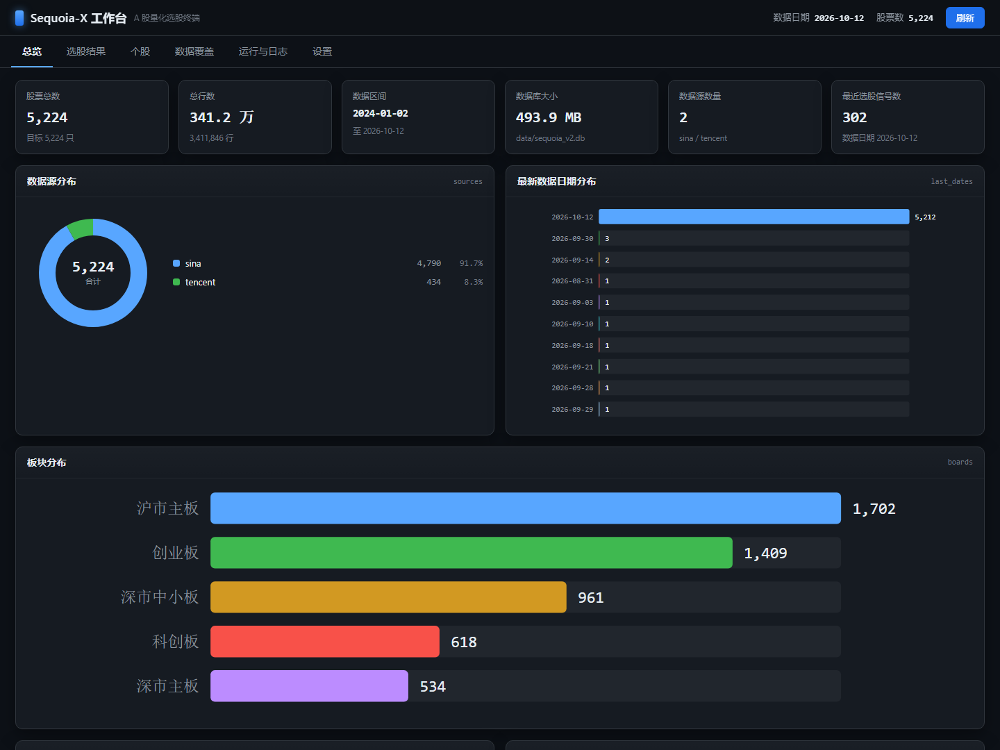
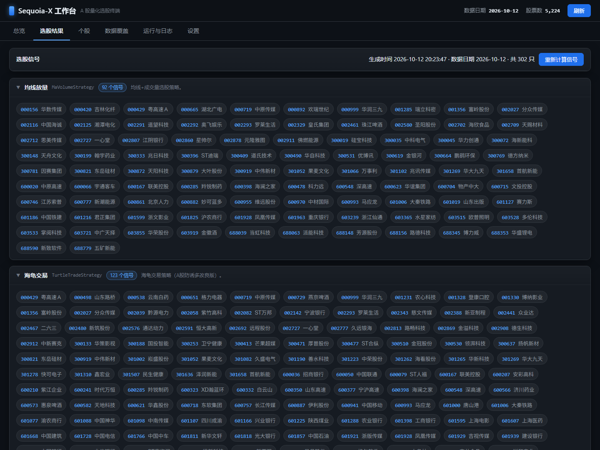
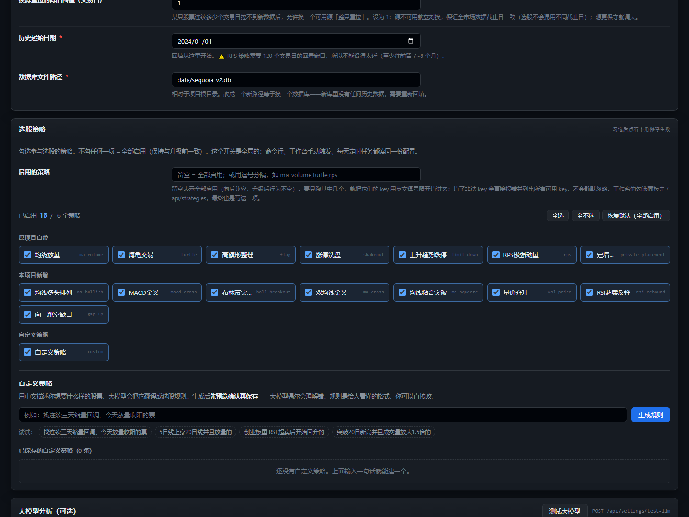

# Sequoia-X: 王者回归 | The King Returns

> A 股量化选股系统 V2 | A-Share Quantitative Stock Selection System V2

[](https://github.com/sngyai/Sequoia-X)
[](#-windows-一键安装包)
[](https://www.python.org/)

---

## ⚠️ 关于这个仓库（二次开发声明）| About This Fork

**这是 [sngyai/Sequoia-X](https://github.com/sngyai/Sequoia-X) 的二次开发分支，不是原项目。**

| | |
|---|---|
| **原项目** | [sngyai/Sequoia-X](https://github.com/sngyai/Sequoia-X) |
| **原作者** | [@sngyai](https://github.com/sngyai) |
| **本仓库** | 在原作者代码基础上的二次开发，**不是官方版本** |
| **本分支定位** | 让这个项目从「会 Python 的人跑脚本」变成「**任何人双击安装包就能用**」 |

原项目的**核心价值**——7 个选股策略的算法、数据引擎的整体设计、飞书卡片推送、
向量化计算与增量更新的思路——**全部来自原作者**。本分支做的是工程化包装和
数据源适配，没有重新发明策略。如果你是冲着「选股策略」来的，
**请先去给原项目点个 Star**：[sngyai/Sequoia-X](https://github.com/sngyai/Sequoia-X)。

> 📌 **遇到的问题请先分清是哪个仓库的**：策略算法、原 baostock 数据层相关的问题属于原项目；
> Windows 安装包、Web 工作台、多数据源换源、大模型分析相关的问题才属于本分支。

> 📦 **同一作者的另一个版本**：飞牛 fnOS 原生应用版在
> [HarmonyRun/Sequoia-X-fnOS](https://github.com/HarmonyRun/Sequoia-X-fnOS)
> ——那个仓库保留了对上游的 GitHub fork 关系（GitHub 限制：同一上游在一个账号下只能有一个 fork）。
> 本仓库是 **Windows 桌面版**，两者同源但各自独立发布，按需取用。

---

## 本分支做了什么 | What This Fork Adds

| 改动 | 说明 |
|---|---|
| 🖥️ **Windows 一键安装包** | 约 80 MB 的单文件 `Sequoia-X-Setup.exe`。**不需要命令行、不需要装 Python、不需要配依赖**——内置便携 Python 运行时和全部依赖，双击装完就能用。也不需要管理员权限。 |
| 📊 **Web 工作台**（6 个页面） | 总览 / 选股结果 / 个股 K 线 / 数据覆盖 / 运行与日志 / 设置。数据全不全、策略选出了什么、任务跑没跑成功，一个页面看完，也能点按钮直接跑选股和回填。 |
| 🎯 **选股策略可勾选** | 策略从 **7 个扩到 15 个**（原项目 7 个算法未动 + 新增 8 个经典策略），在「设置 → 选股策略」里勾选启用哪些。**这个开关全局生效**：命令行、工作台手动触发、每天 19:15 计划任务读同一份配置，推送也只推勾选的策略。 |
| ✍️ **自然语言创建策略**（需配大模型） | 用中文描述选股想法（「找连续三天缩量回调、今天放量收阳的票」），大模型翻译成结构化规则，**预览确认后**保存参与选股。生成后会抽样试跑，告诉你大概能选出多少只。 |
| 🔌 **多数据源 + 自动换源** | 东方财富 / 腾讯 / 新浪三源可选，`auto` 模式自动探测，某个源被限流就切下一个继续补。**同一只股票绝不跨源拼接**（三个源的后复权基准实测差 40%，跨源会造假跳空）。 |
| 🤖 **大模型分析** | 选股跑完自动把「当天市场概况 + 各策略选股」交给大模型分析，结果推送飞书。OpenAI 兼容接口，可接 DeepSeek / 通义 / 智谱 / Moonshot / 本地 Ollama。 |
| ⚙️ **网页里改配置** | 飞书 Webhook（带「测试推送」）、数据源参数、策略勾选、计划任务启停、数据库备份、缓存清理——都不用去编辑 `.env`。 |
| 🌐 **数据源从 baostock 换成 akshare** | 原项目用 baostock。实测**作者的机器 IP 被 baostock 拉黑**（`登录失败 10001011 黑名单用户`），长时间未解封，所以改造为 akshare 三源方案。这不是说 baostock 不好，是那台机器的网络环境问题。 |
| 🧪 **修掉 Windows 上失败的测试** | 原项目 5 个测试在 Windows 下失败（路径分隔符等相关）。现已改为跨平台，`pytest` 全绿。 |
| 🐛 **修掉若干数据一致性隐患** | 换源过程中发现的：失败被当成「无数据」导致永不换源、先写数据后记来源导致同股跨源拼接、区间补数因 UNIQUE 冲突整批回滚等。详见 [docs/使用说明.md](docs/使用说明.md) 第六节。 |

### 新增的 8 个选股策略

原项目自带的 7 个策略**算法完全没有改动**（均线放量、海龟交易、高旗形整理、涨停洗盘、上升趋势跌停、RPS极强动量、定增监控）。
在这基础上新增 8 个业界经典策略，都是用本地日线就能算的：

| 策略 | key | 逻辑 |
|---|---|---|
| 均线多头排列 | `ma_bullish` | MA5>MA10>MA20>MA60 且 MA20 抬升，股价站上 MA5 |
| MACD金叉 | `macd_cross` | DIF 上穿 DEA 且发生在零轴上方 + 放量 |
| 布林带突破 | `boll_breakout` | 收盘上穿布林上轨，且带宽处于近 60 日低位（挤压后突破才有效） |
| 双均线金叉 | `ma_cross` | MA5 上穿 MA20 + 放量 |
| 均线粘合突破 | `ma_squeeze` | MA5/10/20/30 粘合 <3% 后放量突破 |
| 量价齐升 | `vol_price` | 三连阳 + 成交量逐日递增 + 创 20 日新高 |
| RSI超卖反弹 | `rsi_rebound` | RSI(14) 超卖后回升 + 收阳 + **下影线承接** |
| 向上跳空缺口 | `gap_up` | 真跳空（今日最低 > 昨日最高）+ 放量收阳 |

> **RSI 策略的条件为什么用「下影线承接」而不是均线**：最初写的是「收盘价仍在 MA60 上方」，
> 实测 600 只样本选出 **0 只**。逐条件排查发现——**MA20 是 20 日均值，股票昨天刚跌到
> RSI 30 以下时它数学上必然还在下行**，所以「刚超卖」和「均线走平/向上」是互斥的，
> 任何均线类趋势过滤在这个策略里都会清零。改用当日盘面判据（下影线占比 ≥0.4）后
> 从 0 只变成 10 只。详见 `docs/自定义策略DSL.md` 的说明。

---

## 界面预览 | Screenshots

**总览** —— 数据健康度、覆盖区间、数据源构成、计划任务状态一眼看完：



**选股结果** —— 各个策略的信号，按策略分组，带股票中文名：



> 截图取自 2026-10-12 的真实数据（5,224 只 / 341 万行 / 302 个信号）。
> 页面还有「个股」（K 线 + 策略命中情况）、「数据覆盖」（哪些股票还缺数据）、
> 「运行与日志」、「设置」四个页面。

---

## 选股策略怎么用 | Using Strategies

### 勾选启用哪些策略

工作台 → **设置 → 选股策略**，勾选后点右下角保存：



- **一个都不勾 = 全部启用**（升级前的旧配置就是这个语义，保证行为不变）
- 全部勾选时会写成空配置，而不是把 15 个 key 全列一遍——将来新增策略能自动生效
- 这个开关**全局生效**：命令行 `python main.py`、工作台点「运行日常选股」、
  每天 19:15 的计划任务，三者读的都是同一份 `.env`，不会出现「工作台关了但定时任务照跑」
- 推送也一样：`run_strategies()` 遍历的就是过滤后的列表，只推勾选的策略

也可以直接编辑 `.env`：

```ini
# 空 = 全部启用
ENABLED_STRATEGIES=
# 只跑这三个
ENABLED_STRATEGIES=ma_volume,turtle,rps
```

### 用自然语言创建策略（需要先配大模型）

工作台 → 设置 → 选股策略 → **自定义策略**：

1. 在输入框用中文描述，例如「找连续三天缩量回调、今天放量收阳的票」
2. 点「生成规则」，等 30~90 秒（大模型翻译 + 抽样试跑）
3. **预览确认**：会显示策略名、试跑命中多少只、命中样例、完整规则 JSON
4. 确认无误后点「保存这个策略」
5. **记得回到上面勾选「自定义策略」并保存设置**，它才会参与选股

**为什么不是直接生成 Python 代码**：生成的代码能读写文件、发网络请求、
引用不存在的列会让整条流水线挂掉，而且用户看不懂、改不动。
规则 JSON 既能被本地校验（指标名/操作符/参数范围都在白名单内）、
又看得懂、还能直接改数字。格式定义见 [docs/自定义策略DSL.md](docs/自定义策略DSL.md)。

大模型的输出不可信，所以流程里有**本地校验 + 失败重试**：校验不过就把错误
回灌给模型让它自己改，最多 3 次。模型的常见错误有编造指标名、把
`{"ind":"const","value":1.5}` 写成 `{"const":1.5}`、该用 `cross_above` 的地方用 `>`。

---

## 快速开始 | Quick Start

### 方式一：Windows 安装包（推荐给普通用户）

到本仓库的 **Releases** 页面下载最新的 `Sequoia-X-Setup.exe`，双击安装即可。

1. 选安装位置（默认 `%LOCALAPPDATA%\Programs\Sequoia-X`，**不需要管理员权限**）
2. 点「安装」，等十几秒
3. 装完勾「立即启动」，浏览器会自动打开工作台

**装完第一次要做两件事：**

1. **回填历史数据**——安装包**不含**行情数据（为了让包小到 80 MB）。
   工作台 → 设置 → 数据操作 → **「补齐全市场缺口」**，约 1.5 小时
   （可以关掉浏览器，后台会继续跑）。**不回填就没有任何选股结果。**
2. **填飞书 Webhook**（可选）——设置 → 飞书推送。不填也能用，只是不推送。

第一次启动工作台时，程序会自动登记两个 Windows 计划任务：
每个交易日 **16:00** 回填数据、**19:15** 跑选股并推送。

### 方式二：从源码运行（给开发者）

```bash
# 环境要求：Python >= 3.10
git clone <本仓库地址>          # 建议先 Fork 再 clone 自己的
cd Sequoia-X

# 1. 安装依赖（推荐 uv）
uv sync
# 或
pip install .

# 2. 配置
cp .env.example .env
#    至少填 DATA_SOURCE=auto；飞书 Webhook 可留空

# 3. 首次回填历史数据（约 1.5 小时，可中断续传）
python main.py --backfill

# 4. 日常运行：增量补数据 + 跑策略 + 推送
python main.py

# 5. 打开 Web 工作台（可选）
python -m webui.server        # 浏览器访问 http://127.0.0.1:8899
```

> ⚠️ `.env` 里可以放飞书 Webhook 和大模型 API Key，**已在 `.gitignore` 里**。
> 提交代码前请确认没有把它带上去。

---

## 内置策略 | Strategies

**共 15 个内置策略。** 原项目自带的 7 个算法**完全没有改动**：

| 策略 | key | 说明 |
|---|---|---|
| **TurtleTrade** | `turtle` | 海龟突破：20日新高 + 成交额过亿 + 阳线防诱多，按涨幅排序 |
| **MaVolume** | `ma_volume` | 均线+放量突破 |
| **HighTightFlag** | `flag` | 高而窄的旗形整理突破 |
| **LimitUpShakeout** | `shakeout` | 涨停洗盘回踩确认 |
| **UptrendLimitDown** | `limit_down` | 上升趋势中的跌停反包 |
| **RpsBreakout** | `rps` | 欧奈尔 RPS 相对强度突破 |
| **PrivatePlacement** | `private_placement` | 定增公告监控 |

新增的 8 个经典策略见上面的[本分支改动](#新增的-8-个选股策略)一节。
另有 1 个 `custom` 容器跑用户自定义规则，合计 16 个可勾选项。

---

## 文档 | Documentation

- **[docs/使用说明.md](docs/使用说明.md)** — 完整使用说明。包含：Web 工作台逐页说明、
  大模型分析怎么配、安装包怎么打、**以及作者在 Windows 上踩过的所有坑**
  （baostock 拉黑 IP、东方财富硬限流、三个源后复权基准差 40%、
  追加式 zip 定位公式、中文源码必须带 BOM……）。**遇到问题先翻这里。**
- **[docs/自定义策略DSL.md](docs/自定义策略DSL.md)** — 自然语言选股规则的格式定义：
  可用指标白名单、操作符语义、校验规则、已知限制。想手写规则或理解大模型生成
  的东西，看这份。

## 数据说明 | Data

- **数据源**：东方财富 / 腾讯 / 新浪（akshare），`auto` 模式自动探测换源
  - 原项目用的是 [baostock](http://baostock.com)；本分支换源的原因见上面的改动表
- **复权方式**：后复权（hfq）——历史价格不变，适合增量存储，避免除权导致数据错乱
- **存储**：本地 SQLite（`data/sequoia_v2.db`），可直接拷贝到其他机器使用
- **⚠️ 三个源的后复权基准互不相同**：实测同一只股票同一天价格能差 40%。
  所以程序会把每只股票用的源记在 `symbol_source` 表里，增量更新只认这个源；
  绝不允许同一只股票一半用 A 源、一半用 B 源。

---

## 目录结构 | Project Structure

```
Sequoia-X/
├── main.py                      # 入口：argparse 分发日常/回填模式
├── pyproject.toml               # 依赖声明 + ruff/pytest 配置
├── .env.example                 # 环境变量模板
├── data/                        # SQLite 数据库（运行时生成，不入 git）
│   └── custom_strategies.json   #   自定义策略规则（运行时生成，不入 git）
├── sequoia_x/
│   ├── core/config.py           # Pydantic-settings 配置管理
│   ├── core/logger.py           # rich 结构化日志
│   ├── data/engine.py           # 数据引擎（多源回填 + 自动换源 + SQLite）
│   ├── pipeline.py              # 策略注册表 + 勾选过滤 + 日常流程（命令行与工作台共用）
│   ├── analyze/llm.py           # 大模型分析选股结果            ← 本分支新增
│   ├── analyze/rulegen.py       # 自然语言 → 选股规则           ← 本分支新增
│   ├── strategy/                # 15 个内置策略 + 自定义规则容器
│   │   ├── base.py              #   抽象基类
│   │   ├── (7 个原项目策略)      #   算法未改动
│   │   ├── (8 个新增经典策略)    #   均线多头排列 / MACD金叉 / 布林带突破 …
│   │   ├── custom_rule.py       #   自定义规则包装成标准策略
│   │   └── custom/              #   规则 DSL：指标 / 校验求值 / 持久化
│   └── notify/feishu.py         # 飞书 Webhook 推送
├── webui/                       # Web 工作台（纯标准库，零新依赖）← 本分支新增
│   ├── server.py                #   HTTP 服务 + JSON 接口 + 后台任务
│   ├── envstore.py              #   .env 安全读写 + 设置项校验
│   └── static/                  #   原生 HTML/CSS/JS，图表手写 SVG
├── build/                       # 安装包构建脚本                 ← 本分支新增
├── installer/                   # C# 安装器 / 启动器 / 卸载器源码  ← 本分支新增
├── docs/使用说明.md              # 完整使用说明（含踩坑记录）        ← 本分支新增
├── docs/自定义策略DSL.md         # 自然语言规则的格式定义           ← 本分支新增
└── tests/                       # 属性测试 + 单元测试
```

---

## 自己打安装包 | Build the Installer

不需要 Inno Setup / NSIS / 7-Zip / PyInstaller——用 Windows 自带的
`.NET Framework` 编译器 `csc.exe` 编译 C# 安装器，配一个便携 Python 运行时：

```powershell
cd Sequoia-X
.\build\build-installer.ps1                 # 默认：不含行情数据（约 80 MB）
.\build\build-installer.ps1 -WithData       # 带上行情数据（约 204 MB）
```

产物：`installer\dist\Sequoia-X-Setup.exe`

静默安装（给自动化用）：

```powershell
Sequoia-X-Setup.exe /S /D="D:\Apps\Sequoia-X" [/NoData] [/NoDesktop] [/NoStartMenu] [/AutoStart] [/Launch]
Uninstaller.exe    /S [/KeepData]
```

退出码：`0` 成功 / `1` 通用错误 / `2` 参数错误 / `3` 负载缺失 / `4` 目标目录不可写。

---

## 许可证与归属 | License & Attribution

### 归属

- 原项目：[sngyai/Sequoia-X](https://github.com/sngyai/Sequoia-X)
- 原作者：[sngyai](https://github.com/sngyai)
- 本分支在其基础上二次开发。**原项目及其作者对本项目的核心贡献归其所有。**

### 许可证

原项目的 `README.md` 中声明为 **MIT**，但原仓库中**没有 LICENSE 文件**，
`pyproject.toml` 中也没有 `license` 字段。本分支：

- **保留了原项目的 MIT 声明**并在此明确标注来源；
- **没有为本分支新增 LICENSE 文件**——本分支新增代码的授权方式，
  以及是否需要原作者进一步确认，由本分支作者决定；
- 详细说明见 [NOTICE.md](NOTICE.md)。

如果你要基于**本分支**继续开发，建议同时遵守上游的 MIT 声明并在你的项目中保留
对 `sngyai/Sequoia-X` 的署名。

---

## 免责声明 | Disclaimer

- 本项目为**量化选股信号工具，不构成任何投资建议**。策略信号需自行复核，
  据此操作风险自负。
- 行情数据来自各数据源的公开接口，仅供个人研究学习使用，请遵守各数据源的服务条款，
  不要高频抓取。
- 大模型分析结果由 AI 生成，可能存在事实错误，同样**不构成投资建议**。
- 本分支为非官方二次开发版本，原作者不对本分支的任何问题负责。
